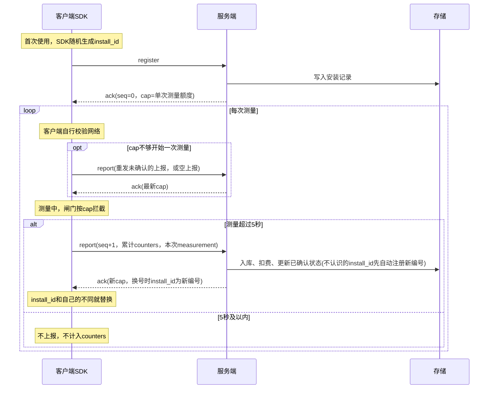

# 蚂蚁阿福服务端设计-demo

## 预计整体通信流程

1. 客户端(安卓、ios)对请求数据进行封包，然后提供给阿福，阿福客户端上传到阿福的服务器中。
2. 阿福的服务器将接受到的请求进行转发，转发到我们的服务器中，也就是现在这个项目中进行处理。
3. 我们的服务器提供统一的http入口，根据报文中的type字段分发到不同的处理逻辑，处理完毕之后对阿福的服务器进行响应。
4. 阿福收到响应数据，将响应数据转发到客户端(安卓、ios)。

## 现阶段通信流程

1. 客户端(安卓、ios)对请求数据进行封包，然后直接传输到当前服务器中。这一阶段没有阿福的服务器。
2. 服务器对接口进行处理响应。响应直接回传到对应的客户端。
3. 客户端根据响应作出对应的处理。

## 使用规则

1. 客户端不能离线使用：检测(即一次测量)前由客户端自行校验网络，服务端不提供探活接口。
2. 时长超过5秒(measurements[].dt_ms > 5000)的测量，无论是否中途退出，结束后都要立即上报并计费；5秒及以内的测量不上报、不计入counters。
3. ack中的cap_frames / cap_runs只放行一次完整测量的用量；上一次测量的ack没收到之前cap不会增加，SDK的闸门会拦住下一次测量。
4. 客户额度(含预支额度)用完时，服务端在ack中返回cap = 已确认，不再放行。
5. cap不够开始一次测量时，SDK先发一次report拿最新的cap：有未确认的上报就重发它，没有就发计数不变、measurements为空的空上报。服务端对空上报不扣费。
6. 上报失败重试时seq和明文内容不变，只重新加密；服务端收到已处理过的seq，直接按当前状态重新返回ack，不重复扣费。
7. 服务端没有上报中的install_id时，会生成新的install_id并直接注册，在ack的install_id字段中返回；客户端发现ack中的install_id和自己的不同，就替换成新的，计数和seq接着用，不需要重新注册。

## 通用约定

### http接口

所有报文都走同一个入口，服务端根据外层的type字段分发处理。

| 项目     | 取值                                            |
| -------- | ----------------------------------------------- |
| 地址     | `POST /v1/meter`                                |
| 请求头   | `Content-Type: application/json; charset=utf-8` |
| 请求type | register：注册；report：用量上报                |
| 响应type | ack：成功；refused：业务拒绝                    |

| 情况                         | http状态码 | 响应体                             |
| ---------------------------- | ---------- | ---------------------------------- |
| 成功(ack)或业务拒绝(refused) | 200        | 外层明文json，业务内容在加密的ct中 |
| 协议错误                     | 400        | 明文json，不加密，见「错误响应」   |
| 服务端内部错误               | 500        | 明文json，不加密，见「错误响应」   |

请求体样例：

```json
{"v": 1, "kid": 1, "type": "register", "ct": "<Base64字符串>"}
```

响应体样例(http 200)：

```json
{"v": 1, "type": "ack", "ct": "<Base64字符串>"}
```

### 加密方案

| 项目    | 取值                                                                                                             |
| ------- | ---------------------------------------------------------------------------------------------------------------- |
| rsa     | 2048位，公钥指数65537；以后升级到3072位只需新增kid，协议不用改                                                   |
| rsa填充 | OAEP，hash = SHA-256，MGF1 hash = SHA-256，label为空                                                             |
| aes     | AES-256-GCM，密钥32字节，每个请求重新生成                                                                        |
| iv      | 12字节，每次加密都重新随机生成；同一个密钥下不能重复使用                                                         |
| tag     | 16字节，拼接在密文之后                                                                                           |
| aad     | 请求：`{v}:{kid}:{type}`，如 `1:1:register`；响应：`{v}:{type}`，如 `1:ack`；数字按十进制、无前导零，取UTF-8字节 |
| 明文    | UTF-8编码的json                                                                                                  |
| 编码    | 标准Base64(RFC 4648)，带`=`填充，不换行                                                                          |

> 请求ct结构：ct = Base64(ek + iv + 密文 + tag)，按字节顺序拼接后整体编码，服务端解码后按kid对应的密钥长度切分

| 段   | 长度         | 说明                                                     |
| ---- | ------------ | -------------------------------------------------------- |
| ek   | 密钥字节长度 | 使用kid对应的rsa公钥加密后的aes密钥；2048位密钥为256字节 |
| iv   | 12字节       | aes的初始向量                                            |
| 密文 | 不定长       | 明文json经aes加密后的结果                                |
| tag  | 16字节       | GCM认证标签                                              |

> 响应ct结构：ct = Base64(iv + 密文 + tag)，按字节顺序拼接后整体编码

| 段   | 长度   | 说明                                                     |
| ---- | ------ | -------------------------------------------------------- |
| iv   | 12字节 | 服务端新随机生成的iv，不能复用请求中的iv                 |
| 密文 | 不定长 | 明文json经aes加密后的结果，密钥为从请求ek中解出的aes密钥 |
| tag  | 16字节 | GCM认证标签                                              |

#### 加解密流程

1. 客户端为每个请求随机生成新的aes密钥(32字节)和iv(12字节)。
2. 客户端从内置的n个rsa公钥中随机选一个加密aes密钥得到ek，并把这个公钥的编号填入kid。
3. 客户端用aes密钥 + iv + aad加密明文json，按「请求ct结构」拼接后Base64编码得到ct。
4. 服务端根据kid找到rsa私钥，Base64解码ct后按该密钥长度切分，解出aes密钥，再用aes密钥 + iv + aad解密并校验tag。
5. 服务端处理完成后，用**同一个aes密钥**和**新随机生成的iv**加密响应明文，按「响应ct结构」拼接后Base64编码得到ct。
6. 客户端用本次请求的aes密钥解密响应；解密或tag校验失败的响应一律丢弃。

> 响应必须换新iv：GCM下同一个密钥重复使用iv，会泄露两段明文的异或，还能反推出认证密钥并伪造密文，中间环节可以借此伪造ack、抬高cap_frames等上限。

#### 双端实现注意

1. Java / Android：不同Provider对 `OAEPWithSHA-256AndMGF1Padding` 的MGF1默认值不一致(SunJCE默认是SHA-1)，必须显式传参 `new OAEPParameterSpec("SHA-256", "MGF1", MGF1ParameterSpec.SHA256, PSource.PSpecified.DEFAULT)`。
2. Java / Android：`AES/GCM/NoPadding` 的 `doFinal` 输出已经是 密文 + tag。
3. Android：Base64使用 `Base64.NO_WRAP`，默认的 `Base64.DEFAULT` 会插入换行。
4. iOS：rsa使用 `SecKeyAlgorithm.rsaEncryptionOAEPSHA256`；aes使用CryptoKit时，`AES.GCM.SealedBox.combined` 正好是 iv + 密文 + tag。

### 错误响应

协议层错误(服务端无法解密请求，或解密后的明文不合法)返回http 400 + 明文json，不加密：

```json
{"code": "decrypt_failed", "msg": "decrypt failed"}
```

| code                | 触发条件                                                                                                              |
| ------------------- | --------------------------------------------------------------------------------------------------------------------- |
| bad_request         | 请求体不是合法json；外层字段缺失或类型错误；ct不是合法Base64，或解码后长度不足(ek长度 + 12 + 16，2048位密钥为284字节) |
| unsupported_version | v不支持(当前只支持1)                                                                                                  |
| unknown_type        | type不是register / report                                                                                             |
| unknown_kid         | kid不存在                                                                                                             |
| decrypt_failed      | rsa解密失败或GCM tag校验失败；两种情况返回完全相同的code和msg，防止被当作padding oracle利用                           |
| bad_payload         | 解密成功，但明文不是合法json，或字段缺失、类型错误、取值非法                                                          |

服务端内部错误返回http 500 + `{"code": "internal_error", "msg": "internal error"}`。

客户端处理：

1. 明文错误响应没有经过认证，中间环节可以伪造。客户端收到后只记录日志并稍后重试，不能据此删除本地状态或更换install_id。
2. 收到unknown_kid时，换一个其他的kid重试一次。

## 接口设计

### 客户端注册请求

#### 过程描述

客户端本地生成aes密钥，并结合提前内置的rsa公钥(内置n个，选取一个随机编号的公钥)对aes密钥进行加密，并使用这个aes密钥对明文json进行加密。最后形成一个外层明文，内部包含密文的结构体，type为register，然后发送这个完整的结构体。加解密细节见「加密方案」。

#### 字段描述

> 外层字段描述

| 字段 | 说明                                           | 样例         |
| ---- | ---------------------------------------------- | ------------ |
| v    | 协议版本                                       | 1            |
| kid  | rsa公钥编号                                    | 1            |
| type | 报文类型                                       | register     |
| ct   | Base64(ek + iv + 密文 + tag)，见「请求ct结构」 | Base64字符串 |

> 明文字段描述(ct解密后)

| 字段       | 说明                                                                                                                                                                            | 样例                             |
| ---------- | ------------------------------------------------------------------------------------------------------------------------------------------------------------------------------- | -------------------------------- |
| install_id | 安装编号：SDK 随机生成                                                                                                                                                          | ebedf529617fd42a433665cfd9150d46 |
| app_key    | 我方发给客户的 App Key（阿福在 meter_open 时传入）                                                                                                                              | AK-demo                          |
| app_id     | 包名或 Bundle ID，SDK 自己读取                                                                                                                                                  | com.example.app                  |
| sdk        | sdk版本                                                                                                                                                                         | 1.1.0-beta.1                     |
| platform   | 平台：android / ios                                                                                                                                                             | android                          |
| reset      | 新安装的原因：空 = 第一次，corrupt = 文件损坏，unregistered = 上报时服务端没有该编号(服务端自动换号时记在安装记录里，客户端不会发送)，conflict = 注册时编号被拒(服务端暂不返回) | ""（第一次）                     |
| ts         | 生成时间（Unix 毫秒）                                                                                                                                                           | 1792478738168                    |

明文样例：

```json
{
  "install_id": "ebedf529617fd42a433665cfd9150d46",
  "app_key": "AK-demo",
  "app_id": "com.example.app",
  "sdk": "1.1.0-beta.1",
  "platform": "android",
  "reset": "",
  "ts": 1792478738168
}
```

### 服务端注册请求响应

#### 过程描述

根据结构体中的kid字段找到对应的rsa私钥，用这个私钥解密ek得到aes密钥，并对密文进行解密，得到明文json。解密失败等协议错误返回明文的http 400(见「错误响应」)。解密成功后，install_id不存在则注册相关的信息(入库)；已存在则视为客户端重试，不改数据。两种情况都返回ack。响应使用同一个aes密钥和新随机生成的iv加密。详细步骤见「服务端处理流程」。

#### 字段描述

> 外层字段描述

| 字段 | 说明                                      | 样例         |
| ---- | ----------------------------------------- | ------------ |
| v    | 协议版本，与请求相同                      | 1            |
| type | 报文类型(ack/refused)                     | ack          |
| ct   | Base64(iv + 密文 + tag)，见「响应ct结构」 | Base64字符串 |

> 明文字段描述(报文类型为ack时)

| 字段       | 说明                                                                                 | 样例                             |
| ---------- | ------------------------------------------------------------------------------------ | -------------------------------- |
| install_id | 安装编号；和请求中的不同时，表示服务端已自动换号，客户端替换成这个新编号             | ebedf529617fd42a433665cfd9150d46 |
| seq        | 确认到第几份；回复注册时为 0                                                         | 1（回复注册时为 0）              |
| cap_frames | 新的帧数上限 = 已确认的counters.frames_ok + 单次测量额度；额度用完时不加单次测量额度 | 300                              |
| cap_runs   | 新的 run 上限 = 已确认的counters.run_ok + 单次测量额度；额度用完时不加单次测量额度   | 10                               |
| ttl_sec    | 上限有效期（秒）                                                                     | 86400                            |
| report_sec | 上报间隔（秒）                                                                       | 60                               |

> 单次测量额度：一次完整测量最多用到的帧数 / run 次数，由服务端配置(上限由算法给出)

明文样例(回复注册)：

```json
{
  "install_id": "ebedf529617fd42a433665cfd9150d46",
  "seq": 0,
  "cap_frames": 300,
  "cap_runs": 10,
  "ttl_sec": 86400,
  "report_sec": 60
}
```

> 明文字段描述(报文类型为refused时；注册和上报目前都不会返回refused，保留给后续的业务拒绝)

| 字段       | 说明                   | 样例                             |
| ---------- | ---------------------- | -------------------------------- |
| install_id | 安装编号：SDK 随机生成 | ebedf529617fd42a433665cfd9150d46 |
| reason     | 拒绝原因，见下表       | unregistered                     |

| reason       | 出现场景 | 含义                                                                     | SDK处理                              |
| ------------ | -------- | ------------------------------------------------------------------------ | ------------------------------------ |
| conflict     | 暂不使用 | 保留值；当前重复注册一律按客户端重试返回ack，服务端不会返回              | 换新编号，以reset = conflict重新注册 |
| unregistered | 暂不使用 | 保留值；服务端没有该编号时会自动注册新编号并在ack中返回，不再返回refused | 无                                   |

明文样例：

```json
{"install_id": "ebedf529617fd42a433665cfd9150d46", "reason": "unregistered"}
```

### 客户端用量上报请求

#### 过程描述

客户端依旧和注册请求时一样，随机选择rsa公钥，并对再次生成的aes密钥进行加密(每一轮的对话都会使用新的aes密钥)，并和注册请求上传时一样对明文json进行加密，type为report，然后上传整体的结构体。上报时机见「使用规则」。

#### 字段描述

> type字段的值为report，其他外层字段和ct结构都和注册请求时一样

> 明文字段描述(ct解密后)

| 字段                    | 说明                                                   | 样例                             |
| ----------------------- | ------------------------------------------------------ | -------------------------------- |
| install_id              | 安装编号：SDK 随机生成                                 | ebedf529617fd42a433665cfd9150d46 |
| app_key                 | 同注册；服务端没有该编号、需要自动注册时使用           | AK-demo                          |
| app_id                  | 同注册；用途同上                                       | com.example.app                  |
| platform                | 同注册；用途同上                                       | android                          |
| seq                     | 序号，每份加 1：去重、防重放、发现丢包；失败重试时不变 | 1                                |
| ts                      | 生成时间（Unix 毫秒）                                  | 1792478748241                    |
| sdk                     | sdk版本                                                | 1.1.0-beta.1                     |
| counters.sessions       | 测量次数（累计）                                       | 1                                |
| counters.frames_ok      | 有效帧数（累计，计费）                                 | 300                              |
| counters.dt_ms          | 测量时长，毫秒（累计，计费）                           | 9966                             |
| counters.mono_ms        | 同一时长按 SDK 时钟测（对照时间戳是否造假）            | 9968                             |
| counters.run_ok         | run 次数（累计，计费）                                 | 10                               |
| counters.gated_frames   | 被闸门拒绝的帧数（累计）                               | 1                                |
| counters.gated_runs     | 被闸门拒绝的 run 次数（累计）                          | 0                                |
| measurements            | 数组：本次上报的测量，正常 1 条；空上报时为空数组      | [{…}]                            |
| measurements[].no       | 单次编号：第几次测量（最后一条 = counters.sessions）   | 1                                |
| measurements[].start_ts | 单次开始测量时间：第一帧被接受（Unix 毫秒）            | 1792478738236                    |
| measurements[].end_ts   | 单次结束测量时间：最后一帧被接受（Unix 毫秒）          | 1792478748205                    |
| measurements[].frames   | 这次测量的有效帧数                                     | 300                              |
| measurements[].dt_ms    | 这次测量的时长，毫秒（算法同 counters.dt_ms）          | 9966                             |

> counters中的sessions、frames_ok、dt_ms、mono_ms、run_ok只累计时长超过5秒的测量

明文样例：

```json
{
  "install_id": "ebedf529617fd42a433665cfd9150d46",
  "app_key": "AK-demo",
  "app_id": "com.example.app",
  "platform": "android",
  "seq": 1,
  "ts": 1792478748241,
  "sdk": "1.1.0-beta.1",
  "counters": {
    "sessions": 1,
    "frames_ok": 300,
    "dt_ms": 9966,
    "mono_ms": 9968,
    "run_ok": 10,
    "gated_frames": 1,
    "gated_runs": 0
  },
  "measurements": [
    {
      "no": 1,
      "start_ts": 1792478738236,
      "end_ts": 1792478748205,
      "frames": 300,
      "dt_ms": 9966
    }
  ]
}
```

### 服务端用量上报响应

#### 过程描述

和之前的解密方式一样，提取密文并进行解密，解密失败等协议错误返回明文的http 400(见「错误响应」)。如果服务端没有该install_id的注册记录，生成新的install_id，用上报中的app_key、app_id、platform直接注册，以本次counters作为已确认基线，在ack的install_id中返回新编号。如果seq已经处理过(客户端重试)，直接按当前状态重新返回ack，不重复扣费。否则对相关的数据进行入库存储，计算相关的视频时长，进行相关的扣费逻辑(空上报计数不变，不扣费)，如果客户的剩余额度到达了预警值，对客户进行通知，如果客户额度已经没有，就使用预支额度进行扣费(额度由商务进行决定)。然后根据用户是否还有剩余额度返回ack：还有额度时cap = 已确认 + 单次测量额度，额度(含预支)用完时cap = 已确认。详细步骤见「服务端处理流程」。

#### 字段描述

外层字段与注册响应相同，目前只会返回ack：明文字段和注册响应的ack完全相同，seq为已确认的最大上报序号；服务端自动换号时install_id为新编号。

## 服务端处理流程

> 与技术栈无关；标注「留桩」的部分等计费细则同步后再实现

### 整体时序



> 以后阿福转发阶段，报文原样透传，服务端流程不变

### 通用处理(所有请求)

1. 接收 `POST /v1/meter`，请求体超过大小上限(如64KB)直接拒绝。
2. 解析外层json，校验v、kid、type、ct是否存在、类型是否正确，失败返回bad_request。
3. v不支持返回unsupported_version；type不是register / report返回unknown_type。
4. 按kid取rsa私钥，不存在返回unknown_kid。
5. Base64解码ct，长度不足(ek长度 + 12 + 16)返回bad_request；按长度切分出ek、iv、密文 + tag。
6. 用私钥解出aes密钥，再用aes密钥 + iv + aad(`{v}:{kid}:{type}`)解密并校验tag；任一步失败都返回decrypt_failed。
7. 解析明文json并校验字段，失败返回bad_payload。
8. 按type分发到「注册处理」或「上报处理」，得到响应type(ack / refused)和响应明文。
9. 生成新的随机iv，用同一个aes密钥 + aad(`{v}:{type}`)加密响应明文，组装外层json，返回http 200。
10. 处理中出现未预期的异常，返回http 500 internal_error。

> aes密钥只在本次请求的内存中使用；aes密钥和rsa私钥都不落库、不打日志

### 注册处理

1. 按install_id查安装记录。
2. 不存在：
   1. 校验app_key、app_id(规则随计费细则同步，先留桩放行)。
   2. 写入安装记录，已确认seq = 0，已确认counters全为0。install_id唯一，并发写入冲突时按「已存在」处理。
   3. 按「cap计算」得到cap，返回ack(seq = 0)。
3. 已存在：视为客户端重试(上次的ack丢了)，不比对app_key、app_id，不改数据，按当前状态返回ack。

### 上报处理

1. 按install_id查安装记录；查不到时再按「原install_id」查，查到说明已经换过号(上次的ack丢了，客户端拿旧编号重试)，后续使用查到的这条记录。
2. 都查不到：自动注册新编号，完成后直接返回，不走后面的步骤：
   1. 校验app_key、app_id(规则随计费细则同步，先留桩放行)。
   2. 生成新的install_id(32位小写hex随机数，与客户端生成的格式一致)。
   3. 写入安装记录：原install_id = 请求中的编号，app_key、app_id、platform、sdk取自本次上报，reset = unregistered，已确认seq = 本次seq，已确认counters = 本次counters(作为基线，历史用量不重复扣费)。原install_id唯一，并发写入冲突时按第1步查到处理。
   4. 保存本次上报和measurements；触发换号的这次测量是否计费随计费细则定(留桩)。
   5. 按「cap计算」得到cap，返回ack(install_id = 新编号，seq = 本次seq)。
3. 对这条安装记录加锁(行锁或分布式锁，随技术栈定)并重新读取，同一个install_id的上报串行处理；第5步的入库和更新在同一个事务里完成。
4. seq ≤ 已确认seq：重复上报(客户端重试或乱序到达)，不入库、不扣费，直接到第6步。
5. seq > 已确认seq：
   1. 保存原始上报明文(install_id + seq唯一)，用于对账和审计。
   2. 保存measurements(install_id + no唯一，重复的no忽略)。
   3. 计算增量 = 本次counters - 已确认counters；空上报增量为0；增量为负时按0处理并记录异常(暂定)。
   4. 按增量扣费、判断额度、使用预支额度(留桩)。
   5. 更新安装记录：已确认seq = 本次seq，已确认counters = 本次counters。
   6. 提交事务；需要预警时在事务外异步通知客户(留桩)。
6. 按「cap计算」得到cap，返回ack(install_id = 这条记录的编号，seq = 已确认seq)。

### cap计算

1. 客户还有额度：cap_frames = 已确认counters.frames_ok + 单次测量额度，cap_runs = 已确认counters.run_ok + 单次测量额度。
2. 客户额度(含预支额度)用完：cap_frames = 已确认counters.frames_ok，cap_runs = 已确认counters.run_ok。
3. ttl_sec、report_sec取配置值。
4. 单次测量额度和额度判断留桩，随计费细则同步。

### 数据实体(逻辑模型)

| 实体                 | 主要字段                                                                                                                               | 说明                                 |
| -------------------- | -------------------------------------------------------------------------------------------------------------------------------------- | ------------------------------------ |
| rsa密钥              | kid、私钥、状态(启用 / 下线)                                                                                                           | 私钥放配置或密钥管理服务，不放业务库 |
| 安装记录             | install_id(唯一)、原install_id(换号时记录，唯一)、app_key、app_id、platform、sdk、reset、注册时间、已确认seq、已确认counters、更新时间 | 每个install一条                      |
| 上报记录             | install_id + seq(唯一)、ts、原始明文json、接收时间                                                                                     | 对账、审计                           |
| 测量记录             | install_id + no(唯一)、start_ts、end_ts、frames、dt_ms                                                                                 | 单次测量明细                         |
| 客户、额度、扣费流水 | 随计费细则同步                                                                                                                         | 留桩                                 |
