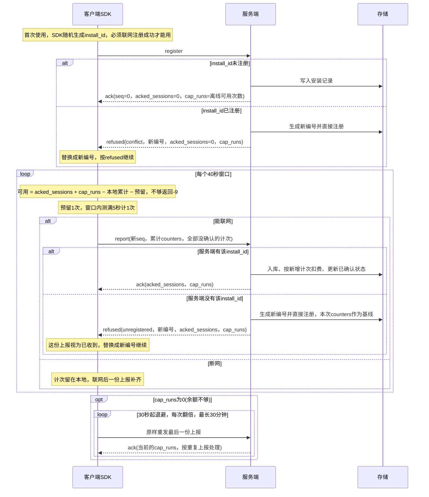

# 蚂蚁阿福服务端设计-demo

## 预计整体通信流程

1. 客户端(安卓、ios)对请求数据进行封包，然后提供给阿福，阿福客户端上传到阿福的服务器中。
2. 阿福的服务器将接受到的请求进行转发，转发到我们的服务器中，也就是现在这个项目中进行处理。
3. 我们的服务器提供统一的http入口，根据报文中的type字段分发到不同的处理逻辑，处理完毕之后对阿福的服务器进行响应。
4. 阿福收到响应数据，将响应数据转发到客户端(安卓、ios)。

## 现阶段通信流程

1. 客户端(安卓、ios)对请求数据进行封包，然后直接传输到当前服务器中。这一阶段没有阿福的服务器。
2. 服务器对接口进行处理响应。响应直接回传到对应的客户端。
3. 客户端根据响应作出对应的处理。

## 使用规则

### 计次

1. 计费单位是「计次」：一次测量按 40 秒切成窗口(从窗口内第一帧被接受开始算)，窗口内测满 5 秒(> 5000 ms)计 1 次，不满或正好 5 秒不计。停止测量必须调用 reset 或 release，当前窗口随之结束。
2. 5 秒和 40 秒都按 SDK 自己的单调时钟计算，不用帧时间戳，也不用设备时间。
3. counters.sessions 是累计计次，服务端按「本次 − 已确认」的差额扣费；counters 里的其他计数只累计计了次的窗口。

### 额度

1. 可用次数 = acked_sessions + cap_runs − 本地累计计次 − 预留。每个窗口开始前先预留 1 次，不够就拦住(SDK 返回 -9)；已经开始的窗口能测满 40 秒，所以长测量跨窗口时也可能被拦。
2. cap_runs 是「从 acked_sessions 往后还能新增几次」，即离线可用次数：跟 App Key 绑定，在内部后台配置(默认5，范围0~16)。设备不联网时最多先用这么多次，联网上报后按新增计次扣费。
3. 第一次必须注册成功、拿到回复后才能使用，拿到回复前可用次数按0算。没注册就用掉的次数，服务端换号时会当作基线，不会扣费。
4. 按次计费，额度按 App Key 计：内部后台给每个 App Key 定单价(元/次)、余额、透支额度；每次上报按「新增计次 × 单价」从余额扣，余额可以扣到负数(透支)。余额加透支额度不够付下一次时，回复的 cap_runs 为0；单价为0表示不收费。
5. 已经放出去的次数不会收回：停发前设备手里的次数照常能用，联网补报时照常扣费，余额可能扣到透支额度以下。
6. ttl_sec 为0或不带表示额度不限时；cap_frames、report_sec 可以不带，SDK 不用。

### 上报

1. 什么时候发：每计 1 次立刻发；测量结束时 counters 有变化再发一份(不计次、不扣费)；App 启动时有没确认的计次就补发。同一时间只有一份在途。联网状态由客户端自己判断，服务端不提供探活接口。
2. 发什么：最新的累计 counters + 全部没确认的计次记录(no > acked_sessions)，最多16条。
3. seq：
   1. 30 秒没收到回复：内容没变就用原 seq 重发(明文不变，只重新加密)；有变化就换新 seq，合成一份。
   2. 收到回复之后、或 App 重启之后再发：一律用新 seq，取 max(本地 seq, 回复的 seq) + 1。
   3. 同一个 seq 只能对应一份内容，发出去之后不能再用于别的内容，重启后也一样。
   4. 只想查最新额度(没有没确认的计次)：把最后一份原样重发，服务端按重复上报处理，不入库；还没上报过就发一份 seq = 1、计数为0、measurements 为空的空上报。
4. 收到 ack / refused：本地累计取 max(本地, acked_sessions)，本地 seq 取 max(本地, 回复的 seq)，no ≤ acked_sessions 的计次记录视为已确认，可以删除；refused 先换成新的 install_id 再做这些。
5. 失败重试：超时、断网、收到明文错误(4xx/5xx)，从30秒开始退避、每次翻倍，最长30分钟，网络恢复立刻重发。cap_runs 为0时按同样的节奏查询额度；宿主想开始测量被拦时立刻查一次(30秒内最多一次)。
6. 服务端先落库再回复；seq ≤ 已确认seq 按重复处理，不入库、不扣费，按当前状态回复；所有回复都带 acked_sessions 和 cap_runs。

### 违规

1. 计次记录的起始时间晚于结束时间(start_ts > end_ts，比如测量中途设备时间被往回调)算一次违规。服务端不拒收：照常入库、按计次扣费，同时给这台设备(install_id)累计违规次数；一条计次记录(install_id + no)只算一次，重发、合并重发不重复算。
2. 违规上限跟 App Key 绑定，在内部后台配置(默认3，0 表示不限，最大1000)，改了从下一次回复开始生效。设备的违规次数达到上限后，给它的所有回复 cap_runs 都为0(停发)；上报照常接收、照常扣费，已经放出去的次数照常可以用完。
3. 内部后台的安装详情里可以清零，清零后从下一次回复开始恢复下发；历史累计次数保留。
4. 违规次数跟着 install_id 走：设备清数据重新注册拿到新编号后从0开始。

### 换号和 App Key

1. 服务端换号：注册时install_id已存在(reason = conflict)，或上报时服务端没有该install_id(reason = unregistered)，服务端都会生成新的install_id并直接注册，返回refused：install_id字段就是新编号，其余字段和ack一样带上seq、acked_sessions、cap_runs。客户端收到后把这次请求视为服务端已收到，不再重发；替换成新编号，直接按refused中的值继续使用；计数和seq接着用，不要再发register(会被再次换号)。
2. 唯一性只看install_id；app_key、app_id同一个客户的所有客户端都相同，不参与判断。
3. App Key 由我方在内部后台生成(或导入)并存库，发给客户；注册、上报带的 app_key 必须是已启用的 App Key，否则返回明文 403 invalid_app_key，数据不入库。

## 通用约定

### http接口

所有报文都走同一个入口，服务端根据外层的type字段分发处理。

| 项目     | 取值                                               |
| -------- | -------------------------------------------------- |
| 地址     | `POST /afu/v1/meter`                               |
| 请求头   | `Content-Type: application/json; charset=utf-8`    |
| 请求type | register：注册；report：用量上报                   |
| 响应type | ack：成功；refused：服务端已换号(编号冲突或未注册) |

| 情况                   | http状态码 | 响应体                             |
| ---------------------- | ---------- | ---------------------------------- |
| ack或refused           | 200        | 外层明文json，业务内容在加密的ct中 |
| 协议错误               | 400        | 明文json，不加密，见「错误响应」   |
| app_key 不存在或已停用 | 403        | 明文json，不加密，见「错误响应」   |
| 服务端内部错误         | 500        | 明文json，不加密，见「错误响应」   |

请求体样例：

```json
{"v": 1, "kid": 1, "type": "register", "ct": "<Base64字符串>"}
```

响应体样例(http 200)：

```json
{"v": 1, "type": "ack", "ct": "<Base64字符串>"}
```

### 加密方案

| 项目    | 取值                                                                                                             |
| ------- | ---------------------------------------------------------------------------------------------------------------- |
| rsa     | 2048位，公钥指数65537；以后升级到3072位只需新增kid，协议不用改                                                   |
| rsa填充 | OAEP，hash = SHA-256，MGF1 hash = SHA-256，label为空                                                             |
| aes     | AES-256-GCM，密钥32字节，每个请求重新生成                                                                        |
| iv      | 12字节，每次加密都重新随机生成；同一个密钥下不能重复使用                                                         |
| tag     | 16字节，拼接在密文之后                                                                                           |
| aad     | 请求：`{v}:{kid}:{type}`，如 `1:1:register`；响应：`{v}:{type}`，如 `1:ack`；数字按十进制、无前导零，取UTF-8字节 |
| 明文    | UTF-8编码的json                                                                                                  |
| 编码    | 标准Base64(RFC 4648)，带`=`填充，不换行                                                                          |

> 请求ct结构：ct = Base64(ek + iv + 密文 + tag)，按字节顺序拼接后整体编码，服务端解码后按kid对应的密钥长度切分

| 段   | 长度         | 说明                                                     |
| ---- | ------------ | -------------------------------------------------------- |
| ek   | 密钥字节长度 | 使用kid对应的rsa公钥加密后的aes密钥；2048位密钥为256字节 |
| iv   | 12字节       | aes的初始向量                                            |
| 密文 | 不定长       | 明文json经aes加密后的结果                                |
| tag  | 16字节       | GCM认证标签                                              |

> 响应ct结构：ct = Base64(iv + 密文 + tag)，按字节顺序拼接后整体编码

| 段   | 长度   | 说明                                                     |
| ---- | ------ | -------------------------------------------------------- |
| iv   | 12字节 | 服务端新随机生成的iv，不能复用请求中的iv                 |
| 密文 | 不定长 | 明文json经aes加密后的结果，密钥为从请求ek中解出的aes密钥 |
| tag  | 16字节 | GCM认证标签                                              |

#### 加解密流程

1. 客户端为每个请求随机生成新的aes密钥(32字节)和iv(12字节)。
2. 客户端从内置的n个rsa公钥中随机选一个加密aes密钥得到ek，并把这个公钥的编号填入kid。
3. 客户端用aes密钥 + iv + aad加密明文json，按「请求ct结构」拼接后Base64编码得到ct。
4. 服务端根据kid找到rsa私钥，Base64解码ct后按该密钥长度切分，解出aes密钥，再用aes密钥 + iv + aad解密并校验tag。
5. 服务端处理完成后，用**同一个aes密钥**和**新随机生成的iv**加密响应明文，按「响应ct结构」拼接后Base64编码得到ct。
6. 客户端用本次请求的aes密钥解密响应；解密或tag校验失败的响应一律丢弃。

> 响应必须换新iv：GCM下同一个密钥重复使用iv，会泄露两段明文的异或，还能反推出认证密钥并伪造密文，中间环节可以借此伪造ack、抬高cap_runs等上限。

#### 双端实现注意

1. Java / Android：不同Provider对 `OAEPWithSHA-256AndMGF1Padding` 的MGF1默认值不一致(SunJCE默认是SHA-1)，必须显式传参 `new OAEPParameterSpec("SHA-256", "MGF1", MGF1ParameterSpec.SHA256, PSource.PSpecified.DEFAULT)`。
2. Java / Android：`AES/GCM/NoPadding` 的 `doFinal` 输出已经是 密文 + tag。
3. Android：Base64使用 `Base64.NO_WRAP`，默认的 `Base64.DEFAULT` 会插入换行。
4. iOS：rsa使用 `SecKeyAlgorithm.rsaEncryptionOAEPSHA256`；aes使用CryptoKit时，`AES.GCM.SealedBox.combined` 正好是 iv + 密文 + tag。

### 错误响应

协议层错误(服务端无法解密请求，或解密后的明文不合法)返回http 4xx + 明文json，不加密；app_key 不存在或已停用为403，其余为400：

```json
{"code": "decrypt_failed", "msg": "decrypt failed"}
```

| code                | 触发条件                                                                                                              |
| ------------------- | --------------------------------------------------------------------------------------------------------------------- |
| bad_request         | 请求体不是合法json；外层字段缺失或类型错误；ct不是合法Base64，或解码后长度不足(ek长度 + 12 + 16，2048位密钥为284字节) |
| unsupported_version | v不支持(当前只支持1)                                                                                                  |
| unknown_type        | type不是register / report                                                                                             |
| unknown_kid         | kid不存在                                                                                                             |
| decrypt_failed      | rsa解密失败或GCM tag校验失败；两种情况返回完全相同的code和msg，防止被当作padding oracle利用                           |
| bad_payload         | 解密成功，但明文不是合法json，或字段缺失、类型错误、取值非法                                                          |
| invalid_app_key     | 解密成功，但 app_key 不存在或已停用；http状态码为403                                                                  |

服务端内部错误返回http 500 + `{"code": "internal_error", "msg": "internal error"}`。

客户端处理：

1. 明文错误响应没有经过认证，中间环节可以伪造。客户端收到后只记录日志并稍后重试，不能据此删除本地状态或更换install_id。
2. 收到unknown_kid时，换一个其他的kid重试一次。

## 接口设计

### 客户端注册请求

#### 过程描述

客户端本地生成aes密钥，并结合提前内置的rsa公钥(内置n个，选取一个随机编号的公钥)对aes密钥进行加密，并使用这个aes密钥对明文json进行加密。最后形成一个外层明文，内部包含密文的结构体，type为register，然后发送这个完整的结构体。加解密细节见「加密方案」。

#### 字段描述

> 外层字段描述

| 字段 | 说明                                           | 样例         |
| ---- | ---------------------------------------------- | ------------ |
| v    | 协议版本                                       | 1            |
| kid  | rsa公钥编号                                    | 1            |
| type | 报文类型                                       | register     |
| ct   | Base64(ek + iv + 密文 + tag)，见「请求ct结构」 | Base64字符串 |

> 明文字段描述(ct解密后)

| 字段       | 说明                                                                                                                                                                                                          | 样例                             |
| ---------- | ------------------------------------------------------------------------------------------------------------------------------------------------------------------------------------------------------------- | -------------------------------- |
| install_id | 安装编号：SDK 随机生成                                                                                                                                                                                        | ebedf529617fd42a433665cfd9150d46 |
| app_key    | 我方发给客户的 App Key（阿福在 meter_open 时传入），必须是服务端已启用的 App Key                                                                                                                              | AK-demo                          |
| app_id     | 包名或 Bundle ID，SDK 自己读取                                                                                                                                                                                | com.example.app                  |
| sdk        | sdk版本                                                                                                                                                                                                       | 1.1.0-beta.1                     |
| platform   | 平台：android / ios                                                                                                                                                                                           | android                          |
| reset      | 新安装的原因：空 = 第一次，corrupt = 文件损坏，unregistered = 上报时服务端没有该编号(服务端自动换号时记在安装记录里，客户端不会发送)，conflict = 注册时编号已存在(服务端换号时记在安装记录里，客户端不会发送) | ""（第一次）                     |
| ts         | 生成时间（Unix 毫秒）                                                                                                                                                                                         | 1792478738168                    |

明文样例：

```json
{
  "install_id": "ebedf529617fd42a433665cfd9150d46",
  "app_key": "AK-demo",
  "app_id": "com.example.app",
  "sdk": "1.1.0-beta.1",
  "platform": "android",
  "reset": "",
  "ts": 1792478738168
}
```

### 服务端注册请求响应

#### 过程描述

根据结构体中的kid字段找到对应的rsa私钥，用这个私钥解密ek得到aes密钥，并对密文进行解密，得到明文json。解密失败等协议错误返回明文的http 400(见「错误响应」)。解密成功后，install_id不存在则注册相关的信息(入库)并返回ack；已存在则生成新的install_id直接注册，返回refused(reason = conflict)，install_id为新编号，并和ack一样带上seq、acked_sessions和cap_runs。响应使用同一个aes密钥和新随机生成的iv加密。详细步骤见「服务端处理流程」。

#### 字段描述

> 外层字段描述

| 字段 | 说明                                      | 样例         |
| ---- | ----------------------------------------- | ------------ |
| v    | 协议版本，与请求相同                      | 1            |
| type | 报文类型(ack/refused)                     | ack          |
| ct   | Base64(iv + 密文 + tag)，见「响应ct结构」 | Base64字符串 |

> 明文字段描述(报文类型为ack时)

| 字段           | 说明                                                                                                                    | 样例                             |
| -------------- | ----------------------------------------------------------------------------------------------------------------------- | -------------------------------- |
| install_id     | 安装编号                                                                                                                | ebedf529617fd42a433665cfd9150d46 |
| seq            | 已确认的最大上报序号；回复注册时为 0                                                                                    | 1（回复注册时为 0）              |
| acked_sessions | 服务端已确认的累计计次；回复注册时为 0                                                                                  | 1（回复注册时为 0）              |
| cap_frames     | 帧数上限：固定为0，表示不按帧数拦截                                                                                     | 0                                |
| cap_runs       | 从 acked_sessions 往后还能新增几次计次：取 App Key 配置的离线可用次数(默认5，范围0~16)；余额加透支额度不够付下一次、或设备违规次数达到上限时为0 | 5                                |
| ttl_sec        | 额度有效期（秒），0 表示不限时                                                                                          | 0                                |
| report_sec     | 上报间隔（秒），SDK 不用                                                                                                | 60                               |

> SDK 可用次数 = acked_sessions + cap_runs − 本地累计计次 − 预留，见「使用规则 / 额度」。

明文样例(回复注册)：

```json
{
  "install_id": "ebedf529617fd42a433665cfd9150d46",
  "seq": 0,
  "acked_sessions": 0,
  "cap_frames": 0,
  "cap_runs": 5,
  "ttl_sec": 0,
  "report_sec": 60
}
```

> 明文字段描述(报文类型为refused时；目前只在服务端换号时出现)

| 字段                                                           | 说明                                         | 样例                             |
| -------------------------------------------------------------- | -------------------------------------------- | -------------------------------- |
| install_id                                                     | 安装编号：服务端新生成的编号，客户端直接替换 | 7c1e9a3b5d2f4e6a8b0c1d3e5f7a9b2c |
| reason                                                         | 拒绝原因，见下表                             | unregistered                     |
| seq、acked_sessions、cap_frames、cap_runs、ttl_sec、report_sec | 和ack完全相同；客户端直接按这里的值继续使用  | 同ack                            |

| reason       | 出现场景 | 含义                                                                     | SDK处理                                                                                                                   |
| ------------ | -------- | ------------------------------------------------------------------------ | ------------------------------------------------------------------------------------------------------------------------- |
| conflict     | 注册     | install_id已被注册，服务端已生成新编号并直接注册                         | 替换成refused中的install_id，按refused中的acked_sessions、cap_runs继续使用，不需要重新注册                                |
| unregistered | 上报     | 服务端没有该编号，已生成新编号并直接注册，这份上报的计数作为基线(不扣费) | 这份上报视为已收到、不再重发；替换成refused中的install_id，按refused中的acked_sessions、cap_runs继续使用，计数和seq接着用 |

明文样例(回复上报，服务端换号)：

```json
{
  "install_id": "7c1e9a3b5d2f4e6a8b0c1d3e5f7a9b2c",
  "reason": "unregistered",
  "seq": 1,
  "acked_sessions": 1,
  "cap_frames": 0,
  "cap_runs": 5,
  "ttl_sec": 0,
  "report_sec": 60
}
```

### 客户端用量上报请求

#### 过程描述

客户端依旧和注册请求时一样，随机选择rsa公钥，并对再次生成的aes密钥进行加密(每一轮的对话都会使用新的aes密钥)，并和注册请求上传时一样对明文json进行加密，type为report，然后上传整体的结构体。上报时机、seq规则见「使用规则 / 上报」。

#### 字段描述

> type字段的值为report，其他外层字段和ct结构都和注册请求时一样

> 明文字段描述(ct解密后)

| 字段                    | 说明                                                                                                                          | 样例                             |
| ----------------------- | ----------------------------------------------------------------------------------------------------------------------------- | -------------------------------- |
| install_id              | 安装编号：SDK 随机生成                                                                                                        | ebedf529617fd42a433665cfd9150d46 |
| app_key                 | 同注册，必须是服务端已启用的 App Key；服务端没有该编号、需要自动注册时也用它                                                  | AK-demo                          |
| app_id                  | 同注册；用途同上                                                                                                              | com.example.app                  |
| platform                | 同注册；用途同上                                                                                                              | android                          |
| seq                     | 序号：去重、防重放；没收到回复的重试不变，其余每次发送取新号，见「使用规则 / 上报」                                           | 1                                |
| ts                      | 生成时间（Unix 毫秒）                                                                                                         | 1792478743300                    |
| sdk                     | sdk版本                                                                                                                       | 1.1.0-beta.1                     |
| counters.sessions       | 累计计次（计费）                                                                                                              | 1                                |
| counters.frames_ok      | 有效帧数（累计）                                                                                                              | 151                              |
| counters.dt_ms          | 测量时长，毫秒（累计）                                                                                                        | 5005                             |
| counters.mono_ms        | 同一时长按 SDK 时钟测（对照时间戳是否造假）                                                                                   | 5007                             |
| counters.run_ok         | run 次数（累计）                                                                                                              | 5                                |
| counters.gated_frames   | 被闸门拒绝的帧数（累计）                                                                                                      | 0                                |
| counters.gated_runs     | 被闸门拒绝的 run 次数（累计）                                                                                                 | 0                                |
| measurements            | 数组：全部没确认的计次记录(no > 上次回复的 acked_sessions)，最多16条；在线时正常 1 条，断网后补报时多条，没有新计次时为空数组 | [{…}]                            |
| measurements[].no       | 第几次计次（最后一条 = counters.sessions）                                                                                    | 1                                |
| measurements[].start_ts | 窗口开始：窗口内第一帧被接受（Unix 毫秒）                                                                                     | 1792478738236                    |
| measurements[].end_ts   | 计次那一刻：窗口内测满5秒时被接受的那一帧（Unix 毫秒）                                                                        | 1792478743241                    |
| measurements[].frames   | 窗口开始到计次那一刻的有效帧数                                                                                                | 151                              |
| measurements[].dt_ms    | 窗口开始到计次那一刻的时长，毫秒（算法同 counters.dt_ms），大于5000                                                           | 5005                             |

> counters 只累计计了次的窗口：计次那一刻先累计到当时，窗口结束、测量结束时再补上这个窗口剩下的部分(测量结束时补发一份上报)

明文样例：

```json
{
  "install_id": "ebedf529617fd42a433665cfd9150d46",
  "app_key": "AK-demo",
  "app_id": "com.example.app",
  "platform": "android",
  "seq": 1,
  "ts": 1792478743300,
  "sdk": "1.1.0-beta.1",
  "counters": {
    "sessions": 1,
    "frames_ok": 151,
    "dt_ms": 5005,
    "mono_ms": 5007,
    "run_ok": 5,
    "gated_frames": 0,
    "gated_runs": 0
  },
  "measurements": [
    {
      "no": 1,
      "start_ts": 1792478738236,
      "end_ts": 1792478743241,
      "frames": 151,
      "dt_ms": 5005
    }
  ]
}
```

### 服务端用量上报响应

#### 过程描述

和之前的解密方式一样，提取密文并进行解密，解密失败等协议错误返回明文的http 400(见「错误响应」)。如果服务端没有该install_id的注册记录，生成新的install_id，用上报中的app_key、app_id、platform直接注册，以本次counters作为已确认基线(不扣费)，返回refused(reason = unregistered)，install_id为新编号，并和ack一样带上seq、acked_sessions和cap_runs。如果seq已经处理过(客户端重试、查询额度)，直接按当前状态重新返回ack，不重复扣费。否则对相关的数据进行入库存储，按「新增计次 × 单价」从 App Key 的余额扣费并记一条扣费流水(计次没变的上报不扣费)；余额扣成负数(进入透支)、余额加透支额度不够付下一次(停发)时各发一次预警；起止时间颠倒的计次记录照常扣费，并给这台设备累计违规次数(见「使用规则 / 违规」)。然后返回ack：acked_sessions = 已确认的累计计次；App Key 还够付下一次、且设备违规次数没到上限时cap_runs = 这个 App Key 的离线可用次数，否则cap_runs = 0；cap_frames固定为0。详细步骤见「服务端处理流程」。

#### 字段描述

外层字段与注册响应相同：

1. type为ack时：明文字段和注册响应的ack完全相同，seq为已确认的最大上报序号，acked_sessions为已确认的累计计次。
2. type为refused时：reason为unregistered，install_id为服务端新生成的编号，seq为本次上报的序号，acked_sessions为本次上报的counters.sessions(基线)，明文字段和注册响应的refused相同。

## 服务端处理流程

> 与技术栈无关；标注「留桩」的部分等计费细则同步后再实现

### 整体时序



> 以后阿福转发阶段，报文原样透传，服务端流程不变

### 通用处理(所有请求)

1. 接收 `POST /afu/v1/meter`，请求体超过大小上限(如64KB)直接拒绝。
2. 解析外层json，校验v、kid、type、ct是否存在、类型是否正确，失败返回bad_request。
3. v不支持返回unsupported_version；type不是register / report返回unknown_type。
4. 按kid取rsa私钥，不存在返回unknown_kid。
5. Base64解码ct，长度不足(ek长度 + 12 + 16)返回bad_request；按长度切分出ek、iv、密文 + tag。
6. 用私钥解出aes密钥，再用aes密钥 + iv + aad(`{v}:{kid}:{type}`)解密并校验tag；任一步失败都返回decrypt_failed。
7. 解析明文json并校验字段，失败返回bad_payload。
8. 按type分发到「注册处理」或「上报处理」，得到响应type(ack / refused)和响应明文。
9. 生成新的随机iv，用同一个aes密钥 + aad(`{v}:{type}`)加密响应明文，组装外层json，返回http 200。
10. 处理中出现未预期的异常，返回http 500 internal_error。

> aes密钥只在本次请求的内存中使用；aes密钥和rsa私钥都不落库、不打日志

### 注册处理

> 唯一性只看install_id；app_key、app_id同一个客户的所有客户端都相同，不参与判断

0. app_key 不存在或已停用：返回明文 403 invalid_app_key，不入库。
1. 按install_id查安装记录，不存在：
   1. 校验app_id(规则随计费细则同步，先留桩放行)。
   2. 写入安装记录，已确认seq = 0，已确认counters全为0。install_id唯一，并发写入冲突时按「已存在」处理。
   3. 按「回复字段计算」组装，返回ack(seq = 0，acked_sessions = 0)。
2. 已存在(换号时不记录旧编号；refused丢失时客户端拿旧编号重试，会再换一次号，上一次换出的记录不再使用)：
   1. 生成新的install_id(32位小写hex随机数，与客户端生成的格式一致)。
   2. 写入安装记录：app_key、app_id、platform、sdk取自请求，reset = conflict，已确认seq = 0，已确认counters全为0。
   3. 按「回复字段计算」组装，返回refused(reason = conflict，install_id = 新编号，seq = 0，acked_sessions = 0)。

### 上报处理

0. app_key 不存在或已停用：返回明文 403 invalid_app_key，不入库。
1. 按install_id查安装记录。
2. 查不到：自动注册新编号，完成后直接返回，不走后面的步骤(换号时不记录旧编号；refused丢失时客户端拿旧编号重试，会再换一次号，上一次换出的记录不再使用)：
   1. 校验app_id(规则随计费细则同步，先留桩放行)。
   2. 生成新的install_id(32位小写hex随机数，与客户端生成的格式一致)。
   3. 写入安装记录：app_key、app_id、platform、sdk取自本次上报，reset = unregistered，已确认seq = 本次seq，已确认counters = 本次counters(作为基线，历史用量不重复扣费)。
   4. 保存本次上报和measurements，本次增量记为0；这份上报带的计次是否计费随计费细则定(留桩，现在不扣)；如果计费，refused丢失重试再换号时会再扣一次。带了起止时间颠倒的计次记录时，按「违规」给新编号累计违规次数。
   5. 按「回复字段计算」组装，返回refused(reason = unregistered，install_id = 新编号，seq = 本次seq，acked_sessions = 本次counters.sessions)。
3. 对这条安装记录加锁(行锁或分布式锁，随技术栈定)并重新读取，同一个install_id的上报串行处理；第5步的入库和更新在同一个事务里完成。
4. seq ≤ 已确认seq：重复上报(客户端重试、查询额度或乱序到达)，不入库、不扣费，直接到第6步。
5. seq > 已确认seq：
   1. 计算增量 = 本次counters - 已确认counters(每一项分别算)；计数没变的上报增量为0；某一项增量为负时该项按0处理并记录异常；计次增量超过 cap_runs 时记录异常(SDK 被改过或有 bug)，照常扣费。
   2. 保存原始上报明文和本次增量(install_id + seq唯一)，用于对账、审计和统计。
   3. 保存measurements(install_id + no唯一，重复的no忽略)。起止时间颠倒(start_ts > end_ts)、且这台设备之前没保存过这个编号的计次记录，每条给这台设备累计一次违规(违规记录加行锁，在扣费之前)。
   4. 按本次请求的 App Key 扣费：锁住这个 App Key 的行(同一个 App Key 的扣费串行)，余额减去「counters.sessions 增量 × 单价」，累计计费次数加上增量，记一条扣费流水(install_id、seq、次数、单价、扣后余额)；增量为0不扣费。
   5. 更新安装记录：已确认seq = 本次seq；已确认counters每一项取max(已确认值, 本次值)，只增不减，避免计数变小后把已扣过的用量再扣一次。
   6. 提交事务；余额进入透支、停发额度时，在事务外异步发预警(目前只记日志，通知渠道待定)；累计了违规时记一条异常日志。
6. 按「回复字段计算」组装，返回ack(seq = 已确认seq，acked_sessions = 已确认的counters.sessions)。

### 回复字段计算

1. acked_sessions：已确认的counters.sessions(只增不减)；注册时为0；上报换号时为本次上报的counters.sessions(基线)。
2. cap_runs：App Key 还够付下一次(单价为0，或余额 + 透支额度 ≥ 单价)、且这台设备的违规次数没到这个 App Key 的违规上限时，取这个 App Key 的离线可用次数(内部后台配置，默认5，范围0~16)，否则为0(停发)。
3. cap_frames固定为0，不按帧数拦截；ttl_sec、report_sec取配置值，ttl_sec 默认为0(不限时)。
4. 注册、重复上报、换号时也按这个 App Key 当前是否还有额度、当前的离线可用次数、这台设备当前的违规次数计算(注册拿到的是新编号，没有违规)；改了离线可用次数、违规上限，清零了违规次数，都从下一次回复开始生效。
5. 停发只影响之后的回复：已经放出去的次数照常可以用完，联网补报时照常扣费，所以余额最多比透支额度再低「活跃设备数 × cap_runs × 单价」。其余计费规则随计费细则同步。

### 数据实体(逻辑模型)

| 实体     | 主要字段                                                                                                               | 说明                                 |
| -------- | ---------------------------------------------------------------------------------------------------------------------- | ------------------------------------ |
| rsa密钥  | kid、私钥、状态(启用 / 下线)                                                                                           | 私钥放配置或密钥管理服务，不放业务库 |
| 安装记录 | install_id(唯一)、app_key、app_id、platform、sdk、reset、注册时间、已确认seq、已确认counters、更新时间                 | 每个install一条                      |
| App Key  | app_key(唯一，区分大小写)、备注、状态(启用 / 停用)、单价、余额、透支额度、累计计费次数、离线可用次数、违规上限、创建人、创建时间 | 内部后台生成或导入                   |
| 上报记录 | install_id + seq(唯一)、ts、原始明文json、本次增量(计次、帧数、时长)、接收时间                                         | 对账、审计、统计                     |
| 计次记录 | install_id + no(唯一)、start_ts、end_ts、frames、dt_ms                                                                 | 每次计次一条                         |
| 计费流水 | App Key、类型(扣费 / 充值)、金额、变动后余额、次数、单价、install_id、seq、操作人、备注                                | 每笔扣费、充值一条                   |
| 违规记录 | install_id(唯一)、当前违规次数、历史累计、清零次数、最近一次违规的 seq / 编号 / 时间、最近清零的操作人和时间            | 有过违规的 install 一条；Redis 里有缓存 |
| 客户     | 随计费细则同步                                                                                                         | 留桩                                 |
